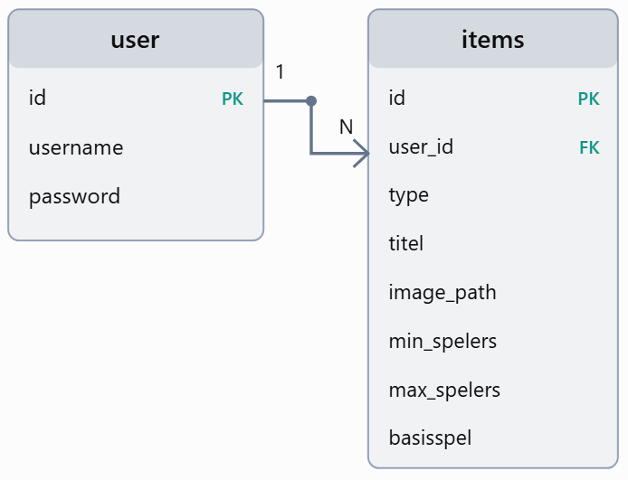

# Databasestructuur – Speelkast

De database `speelkast` bevat twee tabellen: `user` en `items`.

Eén gebruiker kan meerdere spellen of uitbreidingen bezitten, maar ieder item hoort bij één gebruiker. De tabellen zijn gekoppeld via `items.user_id`, dat verwijst naar `user.id`.

## Relatie tussen de tabellen

## Tabel: `user`

| Kolom | Type | Beschrijving |
|---|---|---|
| `id` | INT, PRIMARY KEY, AUTO_INCREMENT | Uniek gebruikers-ID |
| `username` | VARCHAR(100), UNIQUE | Gebruikersnaam voor inloggen en als naam van de eigenaar |
| `password` | VARCHAR(255) | Wachtwoord (uiteindelijk opgeslagen als hash) |

## Tabel: `items`

| Kolom | Type | Beschrijving |
|---|---|---|
| `id` | INT, PRIMARY KEY, AUTO_INCREMENT | Uniek item-ID |
| `user_id` | INT, FOREIGN KEY | Eigenaar; verwijst naar `user.id` |
| `type` | ENUM('bordspel', 'uitbreiding') | Bordspel of uitbreiding |
| `titel` | VARCHAR(150) | Titel |
| `image_path` | VARCHAR(255) | Pad naar de geüploade afbeelding |
| `min_spelers` | INT, NULL | Minimaal aantal spelers (bordspellen) |
| `max_spelers` | INT, NULL | Maximaal aantal spelers (bordspellen) |
| `basisspel` | VARCHAR(150), NULL | Naam van het basisspel (uitbreidingen) |

## Hoe werkt het?

- **Eigenaarschap:** `items.user_id` koppelt een item aan de eigenaar in de tabel `user`. De `username` wordt getoond als `eigenaar`. Er is dus geen aparte kolom `eigenaar`.
- **Bordspellen:** `min_spelers` en `max_spelers` bevatten de aantallen spelers. `basisspel` is `NULL`.
- **Uitbreidingen:** `basisspel` bevat de naam van het bijbehorende bordspel. `min_spelers` en `max_spelers` mogen `NULL` zijn.
- **Afbeeldingen:** de afbeeldingen worden opgeslagen in de map `upload/`. Alleen het relatieve pad (bijvoorbeeld `upload/abc123.jpg`) wordt opgeslagen in `items.image_path`.
