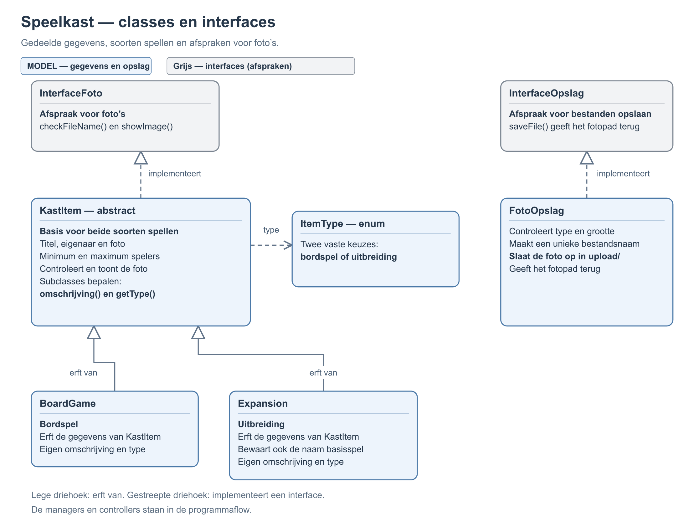
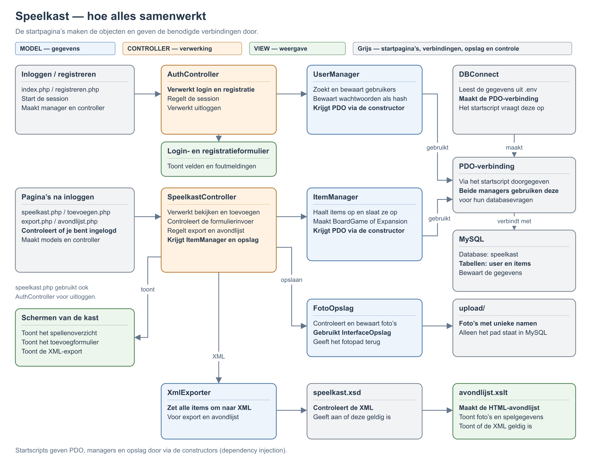

# Speelkast – overzicht

De schema's beschrijven de huidige code, inclusief toevoegen, foto-opslag, registratie en XML/XSD/XSLT. De [README](../../README.md) bevat de uitleg per onderdeel; [ontwerp.md](../../ontwerp.md) geeft een korte samenvatting.

## Classes en interfaces

Een doorgetrokken lijn met een lege driehoek betekent **erft van** (`extends`). Een gestreepte lijn met een lege driehoek betekent **implementeert** (`implements`). Een gestreepte pijl geeft een afhankelijkheid aan.

`BoardGame` en `Expansion` erven van `KastItem`. `KastItem` implementeert `InterfaceFoto`; `FotoOpslag` implementeert `InterfaceOpslag`. De constructors van de managers en controllers staan in de README.

## Programmaflow

De pijlen tonen de belangrijkste aanroepen en gegevensstromen. De startscripts vragen PDO op via `DBConnect` en geven afhankelijkheden door aan constructors. Foto's gaan naar `upload/`; gegevens naar MySQL. De avondlijst wordt gemaakt uit XML via XSD-controle en XSLT.

## Bewerken

[Open het draw.io-bestand](../speelkast.drawio). Het bevat drie tabbladen: Database, Classes en interfaces, en Programmaflow. Exporteer na bewerken het juiste tabblad opnieuw als PNG naar de bestaande afbeeldingslocatie.
